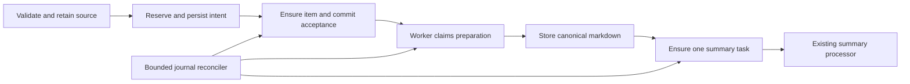
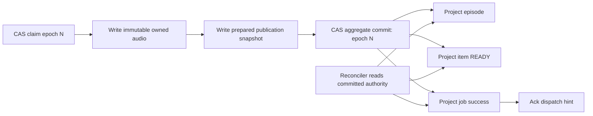

# Architecture follow-up proposals

Status: **design only; not implemented or deployed**. These proposals record the
approved design work, not approval to add fields, change product behavior, enable
release gates, alter credentials, or change resource settings. Implementation
needs a separately reviewed change with tests and an upgrade-in-place plan.

## 1. Readiness without restart loops

### Problem and current evidence

- [Web health](../apps/web/src/app/api/health/route.ts) checks SQL with `SELECT 1`
  but skips metadata validation in Azure-primary mode.
- [Worker health](../apps/worker/src/index.ts) queries a potentially expensive
  stuck-job count, converts a failure to `-1`, and still returns HTTP 200.
  `lastPollAt` advances before awaiting work, so it can be old during a healthy
  long narration.
- [Python health](../services/python-tts/app/main.py) reports package/asset
  discovery and process statistics, not successful construction of every
  configured model. Optional provider absence must not disable another provider.
- Item jobs already renew durable leases in
  [processItemJob](../apps/worker/src/jobs/processItemJob.ts); the three other
  workflows need equivalent observable progress semantics, not an assumed item
  lease. A lease heartbeat proves ownership renewal, not forward progress.

### Proposed contract

Keep all existing health URLs and status semantics unchanged during introduction.
Add separate readiness URLs: web `/api/ready`, worker and Python `/ready`.
Responses use `schemaVersion: 1`, `state: ready|degraded|not_ready`,
`checkedAt`, `expiresAt`, and component `state/reasonCode/lastSuccessAt`.
Return 200 only for ready or a clearly nonessential degraded dependency; return
503 for an unavailable required dependency or unknown/expired required result.
Unknown must not be encoded as success. Do not return credentials, user/job
identifiers, source text, connection strings or raw exception messages.

| Component | Required signal | Not a readiness requirement |
|---|---|---|
| Web | Selected metadata store read using a fixed synthetic probe key/query; bounded storage metadata access for the configured backend | Optional billing/analytics service, every user's object, ability to synthesize |
| Worker | Selected metadata and dispatch access; event-loop progress; current phase/ownership state | A recent new-job poll while actively processing; zero historical stuck jobs; overflow worker actively admitting work |
| Python | Required provider/language initialized successfully; known required assets; not draining/recycling | Every optional provider installed; a new synthesis on each probe |

Use one coalesced check batch per process with a 5-second result TTL, at most
three dependency operations in flight, 750 ms per operation and 2 seconds
overall. Abort supported I/O on deadline. For non-cancelable SDK calls, retain
the single-flight slot until completion so timed-out probes cannot accumulate
background work. Expose a timeout/unknown result, not a fresh successful cache.
These are proposed initial budgets, to be verified against representative
non-production latency before any gate consumes them. No table scan, write,
model construction or inference occurs in the request handling a probe.

Initialize configured models through a separate startup/warm-up action, using
the per-key initialization locks. Record `cold -> initializing -> ready|failed`;
readiness stays false while cold. An initial 300-second startup allowance is a
proposal, not evidence that every model loads within that time. Keep a required
provider failure explicit; optional missing providers remain diagnostic only.
Model readiness is neither proof of enough capacity for any input nor permission
to bypass the later inference-admission policy.

### Progress, ownership and actions

Record in-memory workflow/phase, phase start, last meaningful progress, phase
deadline and last successful ownership renewal for all four worker workflows.
Derive deadlines from their actual configured extraction/TTS/encoding timeouts
and retry budgets; do not infer a stall from the 15-minute default stale-job
window alone. Idle workers use poll-loop progress; intentionally idle overflow
workers are healthy with `admission: disabled_by_policy`.

| Scenario | Readiness / action | Restart? |
|---|---|---|
| Long inference within its phase deadline, ownership renewing | Ready/busy; old `lastPollAt` is informational | No |
| No progress beyond the phase deadline, even with live heartbeat | Not ready/stalled; stop new claims and alert; resolve the active attempt through its lease/cancellation contract | Not solely from this probe |
| Metadata outage or ownership renewal failure | Not ready; pause claims and forbid completion by an unowned attempt | No dependency-outage restart loop |
| Required model/asset missing or initialization failed | Not ready with safe reason code; reject affected new requests | Alert; bounded operator recovery |
| Optional unused provider missing | Ready with optional degradation | No |
| Process/event loop not responding to independent liveness | Existing supervisor policy applies | Only after its existing threshold |

### Consumers and rollout

Current source-controlled consumers are
[Compose](../docker-compose.parity.yml),
[parity startup](../scripts/parity-up.sh),
[CI](../.github/workflows/ci.yml),
[preview prewarm](../scripts/prewarm-kokoro-previews.sh),
[provider discovery](../apps/web/src/lib/tts.ts), and legacy
[deploy](../scripts/azure/deploy-changes.sh) /
[TLS checks](../scripts/azure/configure-tls.sh). Discovery wants capabilities;
startup/release checks want service readiness; a restart monitor wants liveness.
Do not silently redirect them all to the same signal. Inventory externally
managed release/monitoring consumers separately before changing any gate.

1. Add diagnostics and new endpoints in shadow mode; preserve old responses and
   all existing gate/supervisor settings.
2. Test outage, missing asset, expired cache, slow SDK, active long job and
   heartbeat-without-progress cases using controlled dependencies. Assert the
   2-second response ceiling, single-flight bound and safe response shape.
3. Observe false positives across cold starts, valid longest jobs and planned
   recycling. Approve timeout values and each consumer's action explicitly.
4. Migrate one startup/readiness consumer at a time; keep automatic restart on
   independent liveness, not dependency readiness. No changes are enabled now.

No persisted migration is needed for ephemeral diagnostics. If cross-process
progress is later required, design additive fields/compatibility before writing
them. Rollback switches consumers back first, then removes the new endpoints;
it never resets jobs, accounts or model caches.

## 2. Durable acceptance before summary preparation

### Problem and product reconciliation

[enqueueItem](../apps/web/src/lib/items.ts) saves quota/item state, then extracts
and stores markdown in the web process, then creates `ArticleSummaryTask`.
The [task processor](../apps/worker/src/jobs/processArticleSummaryTask.ts) only
discovers tasks and requires existing markdown. A process interruption between
these steps strands an item; moving extraction alone would instead make current
tasks fail for missing markdown.

The [current task contract](article-summary-task-processing.md) and
[summary route tests](../apps/web/tests/summary-mode-routes.test.ts) deliberately
require preparation before task creation. Keep that contract: introduce
discoverable **preparation intent**, not an audio job or an unprepared legacy
summary task. This proposal changes where preparation runs and when users see
extraction failures. It does not claim the old synchronous behavior already
provides durable acceptance.

### Proposed acceptance and ownership

Use the submission-operation journal described in the quota proposal, rather
than a second independent reservation mechanism. Its proposed fields include
protocol version, user-scoped submission ID, request-content hash, stable item
ID, quota reservation reference, durable source reference, preparation phase,
attempt/owner epoch, due time, safe failure and cancellation state.

1. Authenticate and validate input/rate limits in the web request. Preserve URL
   scheme/SSRF rules, PDF type/size checks and transcript-only restrictions.
   Store PDF/snapshot bytes durably before accepting; a browser temporary file,
   expiring download link or web-process-local path is not a recoverable source.
2. Reserve existing-policy capacity and persist recoverable operation intent.
   Create/project the item, then commit the operation as accepted. In SQL,
   quota/item/intent can share a transaction. In Azure, use the account-partition
   journal/reservation protocol; cross-partition item writes remain resumable
   projections, not an imaginary transaction.
3. Return the existing successful response shape/status only after accepted
   intent and its item are durable. Add an operation ID and preparing phase;
   titles may initially be placeholders. A timeout with uncertain commit returns
   an explicit pending/error outcome with the operation ID, not "not charged" or
   "completed." Retrying the same idempotency key resolves that outcome.
4. The worker claims preparation with an owner epoch, extracts through the
   existing adapters, writes owned artifacts, records their hash/reference, then
   idempotently creates the normal summary task. Preparation must be discoverable
   from the authoritative journal even if dispatch/index creation fails.
5. Run preparation as a subqueue of the existing article-summary category,
   alternating preparation and ready-summary work when both are eligible. Keep
   the four-category equal round-robin policy; do not make a fifth priority lane.
   Bound each scan with continuation and rotate partitions, rather than repeatedly
   selecting the first page. Queue messages are hints, not the only evidence.



An idempotency key is scoped to the authenticated user and bound to the immutable
request hash (mode, source and options). Same key/same body returns the original
operation; same key/different body is a conflict. An intentional new submission
uses a new key. Keep a compact deduplication tombstone after cleanup so late
retries cannot become a new charge. Never log the source text or secret URLs.

### Failure and recovery matrix

| Interruption/failure | Durable fact and recovery |
|---|---|
| Upload persisted, no intent | Not accepted; reclaim only demonstrably unreferenced staging bytes after a grace period |
| Capacity reserved, item/acceptance not complete | Journal exposes incomplete operation; conditionally finish it or compensate the unaccepted reservation; do not charge again |
| Acceptance committed, response lost or no worker hint | Same-key retry returns same item; journal reconciliation recreates the hint and preparation work |
| Extraction interrupted | Retry the same operation/source with a bounded attempt budget; no quota call |
| Artifact upload succeeds before metadata save | Reuse a verified object or collect an unreferenced attempt object later; old owners cannot overwrite the winning reference |
| Markdown saved, task creation/phase acknowledgement interrupted | Deterministic task identity plus conditional creation converges to one task; validate existing task ownership/content |
| URL expires or source is unsupported/empty | Persist a terminal, user-visible extraction error and guidance; no hidden audio fallback, infinite fetch retry or new charge |
| Cancellation/deletion races with preparation | Cancellation generation/tombstone fences all subsequent writes; never recreate a deleted item or task |
| Summary provider fails later | Existing bounded task retry behavior; preserve canonical markdown and the same submission identity |

Use current retry classifications as the starting point: transient storage/
network failures may retry with backoff; invalid/expired source failures are
terminal until an explicit user action. A retry of the same accepted work is not
a new quota admission. Accepted extraction failures retain the existing usage
policy; releasing an unaccepted reservation is not a refund-policy change.

### Migration, validation and rollback

This needs additive SQL/Azure journal fields/entities and a worker capability
gate. First deploy readers/reconciler that understand the new protocol, retaining
the current prepared-markdown task contract; then enable new acceptance writers
for a small cohort only after every eligible worker supports preparation.
Old workers may continue processing fully prepared legacy tasks, but must never
receive new preparation records as ordinary summary tasks.

Backfill is a dry-run inventory first: distinguish missing-task items with
verified markdown, interrupted preparations with retained sources, terminal
failures, canceled/deleted items and unknown legacy state. Repair only proven
cases with deterministic identities and conditional writes; report unknown
cases instead of guessing acceptance or replaying usage. Do not reset counters,
rewrite public feed identities, or create audio work for summary-only imports.

Required implementation tests inject a stop before/after each matrix boundary
in both stores, including loss of HTTP response, missing dispatch hint, duplicate
request, stale worker, expired source and delete race. Assert accepted work
converges to one summary or a durable terminal error without another charge.
Update route/UI tests to expect asynchronous extraction and provisional titles.

Rollback disables new-protocol acceptance first and leaves a compatible worker/
reconciler draining existing operations. Do not roll back to binaries unable to
read outstanding intents; retain additive data and the old prepared-task reader.

## 3. Fenced, recoverable episode publication

### Current boundary and invariant

[Item publication](../apps/worker/src/jobs/processItemJob.ts) renews the claim,
then Azure separately upserts an episode, marks the item READY and conditionally
completes the job. The SQL branch groups those metadata changes in one
transaction. [Azure store](../packages/core/src/metadata/azureTablePrimaryStore.ts)
uses different tables for jobs, items and episodes; an Azure Table transaction
cannot make those current writes atomic. A successful lease check before another
table write is not a fence: ownership can change between the two operations.
The explicit item-mutation fix detects failures but does not close this window.

Required invariant: one authoritative committed publication per item generation;
only the current owner can choose it. Audio objects precede that commit; episode,
item and job projections converge afterward. Neither partial projections nor an
old worker may change the result subscribers see.

### Proposed authority and storage mechanics

Introduce an item-keyed publication aggregate, with protocol version, monotonic
generation/owner epoch, current job/claim, lease diagnostics, deletion tombstone,
stable episode identity and committed publication reference. A publication
record holds an immutable snapshot: owner/item/episode IDs, public GUID, title,
description, audio object reference/hash/size/type, publication/expiry dates and
input/rendition identity. Never put source text or credentials in this journal.

- **SQL:** claim/takeover and publication commit condition on the aggregate
  generation and current claim within transactions. Commit the publication,
  episode, item READY and job success together; require one matching owner and
  existing nondeleted item. Use row-lock/conditional-update mechanics appropriate
  to PostgreSQL/SQLite; test both, not just an in-process lock.
- **Azure:** keep ownership and the committed pointer in the **same aggregate
  entity**. Claim/takeover advances its epoch with an exact ETag. The linearizing
  commit is an exact-ETag update of that same entity with matching epoch/claim.
  An old owner's ETag cannot succeed after takeover. Job rows become projections
  for this protocol; do not retain an independent authoritative job lease that
  could disagree with the aggregate. Immutable publication snapshots can be
  separate records written before that pointer commit.
- Lease expiry permits takeover; the epoch/ETag transition is the authoritative
  revocation boundary. Workers stop on locally observed expiry/renewal failure.
  Do not claim that a client-side clock check provides server-enforced exact
  wall-clock expiration for Azure Table writes.
- Readers of new-protocol records must validate the aggregate's committed
  generation/tombstone, including feed eligibility and media resolution.
  Per-row generation checks alone do not fence a cross-table projection race.
  Missing/outdated projections are repaired; missing authority or an outage is
  not interpreted as permission to publish legacy state.

Use the existing public episode ID/GUID/token and media route; a private
publication/attempt ID is not a new subscriber identity. Persist chosen timestamps
once and reuse on retry. Candidate audio is item-owned and immutable (unique
attempt keys with create-if-absent semantics); verify stored size/type/hash before
commit. Old owners can at most leave unreferenced candidates, never overwrite a
committed object's bytes. This extends, not replaces, reference-aware audio
ownership/deletion.



### Crash and stale-owner matrix

Each row covers a stop immediately before the write (previous durable state)
and immediately after it (the new fact exists but its acknowledgement may not).

| Write/boundary | Recovery from before / after |
|---|---|
| Claim epoch | Retry claim / rediscover current owner; never infer claim success from a lost response |
| Candidate audio upload | Retry owned upload / verify and reuse that immutable candidate or leave it for bounded orphan cleanup |
| Owned-artifact metadata | Audio remains unpublished / retain ownership record; repair missing metadata only after object verification |
| Prepared snapshot | Resume from owned audio / same operation can adopt the verified snapshot; no feed visibility yet |
| Aggregate commit | Still uncommitted; current owner may retry / query pointer: matching identity means already committed, conflicting epoch means lost ownership |
| Episode projection | Reconcile from committed snapshot / replay is idempotent and preserves existing episode ID and GUID |
| Item READY projection | Feed reads committed authority, not a half-published item / update only publication fields with row ETag and generation; never recreate a deleted item |
| Job success projection | Resume acknowledgement, not synthesis / duplicate delivery observes committed operation, not a new publication |
| Dispatch delete | Duplicate hint resolves to the same committed result / no additional work required |
| Success event/audit | Repair/deduplicate by publication ID; never undo a committed episode because logging failed / avoid duplicate success events |
| Unreferenced-object cleanup | Retry with ownership/reference checks / never remove a committed, retained or legacy-shared object |

If owner A pauses before commit, B takes epoch N+1, and A resumes, A's aggregate
CAS fails. A must not write successful projections or delete B's objects. If A
commits before B's takeover CAS, B observes the committed result and finishes
projection/acknowledgement instead of synthesizing again. If a stale projector
resumes after a newer commit, monotonic per-row generation conditions reject
known regressions and authoritative reader checks reject any remaining lagging
projection. Deletion/cancellation must advance the same authority/tombstone;
checking an unrelated item flag beforehand is not sufficient.

### Reconciliation and operational limits

Scan a durable, versioned pending-publication index in bounded pages (proposed
100 rows) with continuation, retry backoff and fairness across partitions.
Missing secondary indexes are repaired from the authoritative aggregate scan;
do not restart at page one on every tick. A reconciler only projects committed
snapshots; it cannot invent a commit or treat unreadable storage as absent.
Uncommitted candidates require a grace period longer than maximum attempt/
recovery lifetime and fresh reference checks before collection. Alert on age of
unprojected commits, stale-owner rejection, retry exhaustion and orphan backlog.
No live failure injection or deletion is authorized by this proposal.

### Upgrade, proof and rollback

Add tables/entities/optional generation fields without rewriting existing keys.
Inventory legacy duplicate/partial episodes first; choose canonical identities
from verified existing records and quarantine ambiguity, never mint a replacement
GUID to hide it. Backfill authority for proven legacy published items with their
current IDs, paths and timestamps; preserve null-version legacy reads until
verification. New-protocol reads, claimers, delete/retry flows and reconcilers
must all be deployed before gated writers are enabled. Mixed old writers are
unsafe: a per-cohort writer fence/drain is a required rollout prerequisite.

Tests must pause every matrix write in both backends and prove convergence,
including two owners, two projectors, delete/retry races, lost responses, missing
audio and storage outages. Verify feed GUID/enclosure/token stability, retention,
HEAD/range behavior and no duplicate episode after replay. Measure additional
authority reads before rollout; no performance claim is made by this design.

Rollback disables new claims/writers first and drains committed projections with
a compatible reconciler. Keep the new authority-aware readers until all active
new-protocol records are safely handled. Do not roll back to blind legacy writers,
erase journals, reset jobs or delete objects as a shortcut.

## 4. Idempotent quota reservation and acceptance

### Preserve the policy; repair its durability

[Submission quota](../apps/web/src/lib/submission-quota.ts) currently increments
free usage before Azure item/job creation. Paid admission reads jobs/tasks before
new work exists, so concurrent requests can both see capacity. SQL groups item/
job/free usage in a transaction and conditionally increments free usage; that is
stronger, but a transaction alone is not proof of serialized paid read-then-admit
checks.

Preserve configured free trial plus admin-granted tries, separate paid podcast
and summary windows, and the existing plan-specific limits. `FULL_EPISODE` and
`REQUEST_TTS` share podcast capacity; `SUMMARY_ONLY` uses summary capacity.
Podcast overflow is deferred up to twice the configured daily podcast limit;
summary overflow is rejected rather than deferred. Keep the existing rolling
24-hour/scheduled-start semantics and error/accepted-message contract. This
proposal does not change prices, issue monetary refunds, or merge manual Summary
Studio/digest quotas into submission capacity.

**Mismatch requiring explicit rollout review:** paid summary accounting reads
`ArticleSummaryTask`, but successful tasks are deleted. Completed work can
therefore disappear from the apparent 24-hour usage count. The product spec
describes a daily summary allowance, not a simultaneous-pending-task limit.
Propose retaining accepted usage in the ledger for the whole window, but treat
that observable tightening as a product-compatibility decision before activation;
do not silently "backfill" deleted task history or claim historical usage is known.

### Operation and capacity model

One user-scoped submission key and immutable request hash identify one operation
across retries, item creation, preparation, task/job creation and dispatch.
Persist the capacity kind, observed policy/entitlement version, queue mode,
scheduled slot, stable item/job/task IDs and safe failure reason with it.
Same key/body returns the original outcome; mismatched body conflicts.

```text
validated request -> RESERVED -> ACCEPTED -> processing / succeeded / failed
                         |
                         +----> COMPENSATED (only if acceptance never committed)
```

RESERVED consumes capacity so another request cannot take it. ACCEPTED makes the
same reservation final; it does not increment a second time. Retries of accepted
work never call admission. A new Request TTS operation is distinct from retrying
the original summary. Acceptance failures compensate exactly once; a later
processing failure or deletion does not silently refund free tries or rewrite
the agreed rolling-window policy.

### SQL and Azure protocol

| Backend | Admission linearization and atomic scope |
|---|---|
| SQL | Unique `(userId, submissionId)` operation; serialize on an account admission row/conditional revision, then re-read capacity and reserve within the same transaction as item/intent and initial job when applicable. PostgreSQL row locking or tested serializable transactions with bounded conflict retry; SQLite busy/conflict retry must rerun the whole decision. External billing/network/storage calls stay outside the transaction. |
| Azure | New ledger table, partition per account. Exact-ETag update of its admission revision plus conditional creation of operation and capacity-slot rows in one same-partition transactional batch. Each capacity mutation/compensation advances that revision. Read revision, enumerate relevant slots, then batch with that revision: concurrent changes invalidate the decision and force a fresh bounded retry. Existing user/item/job tables remain projections, not members of this transaction. |

Use time-keyed slot rows for paid rolling windows/future starts and a durable
free-used/held counter, rather than a forever-growing array in one Azure entity.
Current-window and future-slot scans need exact row-key ranges and continuation;
never take an arbitrary newest-N slice before computing capacity. Cap the
future backlog according to policy, archive elapsed capacity rows separately
from compact operation deduplication tombstones, and test entity/batch size
limits. A busy account retries at most three admission conflicts before an
explicit retryable error; do not spin or return a successful guessed snapshot.

Bind policy changes and extra-credit updates to an admission revision too.
Billing remains authoritative for entitlement; do not overwrite billing fields
from a quota projection. Before activation, define how the observed billing
version is synchronized into the account admission epoch and how overlapping
plan changes are serialized. Reading a user row, then writing another table,
does not provide an atomic current-entitlement check. Existing accepted slots
are grandfathered; new admissions use the newly committed policy epoch.

The Azure operation is created before cross-table projections. A reconciler
ensures the stable item and job or summary-preparation intent, validates their
ownership/content, then conditionally transitions RESERVED to ACCEPTED. Dispatch
hints may follow and be repaired. The web response promises acceptance only
after durable acceptance/item state; ambiguous timeouts expose the operation ID
for status/retry, never assume a failed HTTP response means no reservation.

### Crash, contention and compensation proof obligations

| Case | Required outcome |
|---|---|
| Two different requests, one free/paid immediate slot | One reserves it; the other recomputes and rejects or gets a valid podcast deferred slot |
| Two requests, last deferred slot | One reserves it; the other receives the existing quota-full error |
| Duplicate simultaneous key/body | Exactly one operation/reservation; both resolve the same IDs and slot |
| Crash before admission batch/transaction | No reservation; retry is a new attempt at the same operation |
| Crash after reserve, before item | Durable RESERVED operation drives item creation; no second usage increment |
| Crash after item/job, before acceptance acknowledgement | Compare deterministic IDs/content, finish acceptance once; do not recreate work |
| Dispatch/index write fails | Accepted work remains discoverable from journal; repair the hint |
| Permanent failure before acceptance | Fence the operation against later acceptance, remove only its pending projections, release its capacity in the same ledger transaction as COMPENSATED |
| Compensation response lost or racing acceptance | Read operation state; the conditional state/revision transition lets only one outcome win; never blindly decrement a user counter |
| Accepted work fails, is retried or is deleted | Retain accepted usage according to policy; retry does not admit again; tombstone prevents resurrection |
| Billing/admin policy change overlaps | Recompute against the admission policy epoch; never silently mix old allowance with new usage |

An elapsed timeout alone is not proof that a reservation is unused. Compensation
must acquire a newer operation epoch, prove no acceptance commit and fence any
in-flight projector/worker. Readers and workers ignore nonaccepted/tombstoned
projections. Uncertain cross-table state remains explicitly pending for
reconciliation/alerting instead of releasing potentially valid capacity.

### Migration and rollback

Add ledger tables/entities and optional operation references first. Deploy
readers/reconciliation before gated writers, and synchronize every admission/
admin-credit entry point for the chosen cohort; mixed old/new admissions can
bypass the ledger. Seed free usage from verified existing counters, not a recount
of retained items. Inventory paid history including completed/deferred work and
unknown gaps; report differences without changing balances or inventing usage.
Shadow-compare decisions before enforcing them. Quiesce a cohort's admissions
briefly for the baseline/revision cutover, preserving in-flight requests.

Test all matrix cases with SQL and Azure transaction semantics, independent
processes, window boundaries, summary completion, plan changes and manual retry.
Assert held plus accepted capacity and visible accepted work reconcile exactly;
preserve the separate policy behavior for free, paid podcast and paid summary.
No tests against live accounts and no destructive migration are proposed.

Rollback stops new ledger admissions and drains or compensates RESERVED records
under the compatible protocol. Preserve ACCEPTED records and deduplication keys.
Do not resume legacy writers until a verified compatibility projection exists;
never reset counters or drop ledger data to make a rollback appear successful.

## 5. Conservative one-active-inference admission

### Chosen direction and existing behavior

The approved choice is **one active inference**, not measurement-first parallel
admission. [Python synthesis](../services/python-tts/app/main.py) is a synchronous
FastAPI handler, which can run on multiple threads in one server process.
Per-model initialization locks prevent duplicate constructors, not concurrent
inference. Existing active-request/recycle accounting is not an admission gate.

Propose one service-wide permit across Kokoro and Melo, including cold
construction/warm-up, synthesis and WAV encoding. One permit per provider would
still allow overlapping memory-heavy work. A process-local gate is valid only
with one model-serving process: implementation must assert/verify that deployment
assumption. Multiple workers/replicas need a different capacity agreement; this
proposal does not add a distributed semaphore or change resource settings.
The [container command](../services/python-tts/Dockerfile) defaults
`TTS_WORKERS=1` but permits larger values; a future gate must explicitly reject
or account for those configurations rather than assuming the default is enforced.

### Initial bounded policy for review

| Limit | Proposed value / meaning |
|---|---|
| Active model work | 1 across providers/languages |
| Waiting requests | At most 4 validated payloads total |
| Queue wait | At most 15 seconds per request, monotonic deadline |
| Overload | HTTP 503 with safe `error_code: TTS_BUSY`, existing generic detail and `Retry-After: 5` |
| Caller retry | At most 3 admission attempts within a 30-second total admission budget, honoring Retry-After with jitter |
| Active work deadline | Derived from configured input-size/TTS budgets; do not pretend a timed-out native thread has stopped |

These are deliberately conservative proposed starting values, not measurements
of throughput or memory safety. Keep existing input validation/size bounds. Queue
admission must occur in an asynchronous, nonblocking handler before dispatch to a
single dedicated model executor; a semaphore acquired inside the old sync handler
would leave an additional unbounded/opaque wait in the web framework's thread
queue. Authentication and cheap validation remain before admission. Do not
change credentials, expose a bypass, or make health probes join the model queue.

Use FIFO request turns. Each narration chunk re-enters at the tail, so a long
episode cannot reserve the model across its entire chain. Previews and other
waiting callers receive the same turns; no hidden preview-priority lane.
This complements the worker's equal category round-robin but does not promise
per-user fairness from an unaudited caller-supplied identity.

### Lifecycle, cancellation and ownership

```text
validated -> waiting -> active -> response cleanup -> released
               |          |
               |          +-> caller gone: retain permit until actual work ends
               +-> canceled / wait expired: remove waiter; never enter model
```

Admission, timeout and cancellation race under one queue-state lock. A canceled
waiter is removed immediately and cannot later be granted a permit. If active
native inference cannot be interrupted safely, a client timeout/disconnect only
discards its eventual result: **do not release the permit while its thread is
still running**. Release is attached to actual executor completion, not just the
HTTP handler's cancellation/finally path.

Retain the permit through encoding and response-buffer cleanup as well, with
bounded response-send time and disconnect cleanup. Otherwise slow clients can
retain multiple large completed WAV buffers while new inference starts. This
is stricter than inference-only serialization and may reduce throughput.
Every exception, invalid provider/voice, failed constructor and cancellation
must release exactly once when the owned work/buffers truly finish.

A genuinely hung native call makes readiness false and produces an alert;
subsequent waiters expire/reject. Do not start another inference to hide the
hang. Any forced process recovery remains the separately approved supervisor
policy, not an unsafe thread kill. On planned recycling, reject new admissions,
explicitly reject/drain queued requests, finish active work, then use existing
idle-recycle behavior. Count active inference, waiters and response work
separately so waiting requests cannot accidentally satisfy "idle."

### Caller integration and user-visible outcomes

[PythonModelTtsProvider](../packages/core/src/tts/pythonService.ts) currently maps
service failures to a generic 502 and counts them toward its circuit breaker.
[Worker segment retries](../apps/worker/src/jobs/processItemJob.ts) then retry
selected server failures. Implementation must preserve a trusted `TTS_BUSY`
classification and Retry-After through that adapter: overload is retryable
capacity pressure, not evidence that the sidecar has crashed. Do not suppress
real provider/network failures from the breaker or multiply retries at every
layer.

Account for queue time in client deadlines; expiry while active does not free
server capacity. Workers retry the same segment within the admission budget,
then reschedule/fail the existing job under its durable retry policy, never
create a new quota admission. Existing durable caches may be reused; this does
not promise persistence of temporary, partially synthesized chunks.
Preview UI shows "Audio service busy; try again shortly" and does not auto-loop.
Existing nonbusy validation/provider errors retain their own classifications.

| Walkthrough | Expected outcome |
|---|---|
| Long request, then short preview and narration chunks | One active request; FIFO short requests wait up to 15 seconds, then explicit busy rather than indefinite waiting |
| Waiting request canceled | Its slot is removed; next waiter keeps its turn |
| Client cancels active request | No overlapping successor until native work and buffer cleanup finish |
| 1 active + 4 waiters, another request arrives | Immediate 503/TTS_BUSY; no hidden executor backlog |
| Cold constructor fails | Owner and permit release; error is not mislabeled as overload; later allowed request may retry initialization |
| Provider unavailable or service draining | Explicit nonready/draining response; no fallback to another voice/provider |

### Proof, trade-offs and rollout

With controllable fake constructors/inference, test peak in-flight work exactly
1, FIFO ordering across repeated chunks, queue size <=4, 15-second expiry using
a fake clock, all grant/cancel races, and no early release after active timeout.
Test caller retry counts/deadlines, Retry-After handling, breaker classification,
drain/recycle accounting and slow-response cleanup. An isolated real-model
single-request smoke validates function and records peak RSS/latency; it is not
a production load test or proof of a larger safe concurrency limit.

The cost is head-of-line blocking, more explicit busy responses and potentially
unused parallel capacity. One request can still exceed available memory; loaded
models and allocator retention remain resident. More processes invalidate the
bound. Make these trade-offs visible before implementation approval.

Roll out compatible callers/error handling first, then the gated service policy
in an isolated environment, then a separately approved deployment. Observe wait
age, busy count, active count, duration and RSS without source text in logs.
Rollback drains the queue and restores the previous admission behavior under a
coordinated caller/service change; it requires no data migration or credential
change. No runtime gate, queue, timeout, model setting or resource limit changes
are made by this design.

## 6. Locked provider and asset manifest

### Source-backed inventory, not a live-runtime inventory

Kokoro is the enabled end-user narration provider; Melo remains an internal/
experimental service path. The following inventory comes from checked-in build
inputs. It does **not** establish currently installed production versions or
asset hashes, and no model download/upgrade is performed for this design.

| Layer | Known source input | Missing reproducibility evidence |
|---|---|---|
| API packages | [requirements.txt](../services/python-tts/requirements.txt): FastAPI 0.136.1, Uvicorn 0.46.0, NumPy 1.26.4, SoundFile 0.13.1 | Transitive closure, wheel hashes, platform/ABI and native library inventory |
| Provider packages | [requirements.providers.txt](../services/python-tts/requirements.providers.txt): `kokoro>=0.9.4`, `misaki[en]>=0.9.4`, Melo Git URL without commit | Exact supported versions, full Melo commit, source/wheel hashes and transitive dependencies |
| Container runtime | [Dockerfile](../services/python-tts/Dockerfile): `python:3.11-slim`; CPU torch/torchaudio 2.10.0; apt ffmpeg/wget/git | Base image digest, Python patch/ABI, platform-specific wheel hashes, OS/package repository snapshot |
| Local bootstrap | [bootstrap script](../scripts/bootstrap-python-tts.sh): Python 3.11, dependency-file stamp, provider install | Resolved interpreter/build dependencies; a requirements-text stamp is not a lock of resolved inputs |
| Language assets | [container bootstrap](../services/python-tts/bootstrap_assets.py) and local script: spaCy `en_core_web_sm`, UniDic dictionary, NLTK `averaged_perceptron_tagger_eng`, legacy `averaged_perceptron_tagger`, `cmudict` | Download revisions/URLs, file inventories/hashes, licenses and compatibility with resolved packages |
| Model/voice assets | [service constructors](../services/python-tts/app/main.py): `KPipeline(lang_code=...)`; Melo `TTS(language="EN", device="auto")`; configured voice allowlists | Exact upstream model/config/tokenizer/voice revisions and all files selected by provider defaults, cache provenance, device-dependent behavior |
| Validation runtime | [CI](../.github/workflows/ci.yml): API-only Python 3.12/pytest 8.3.5; [real-provider test requirements](../services/python-tts/requirements.test.txt): pytest 8.4.2 | API-only CI is not evidence that the full provider closure works on every Python/platform combination |

Container bootstrap preloads language assets, not an enumerated, hashed set of
all model weights/voices. HF/cache directory environment variables identify
locations, not immutable provenance. Do not copy whatever is in a developer or
shared host cache into a "known-good" manifest without identification.

### Proposed manifest contract

Version one manifest should describe a **verified candidate**, with one lock per
supported platform/ABI/device profile. A Linux CPU lock is not interchangeable
with a macOS native-device build. Record:

- Manifest schema version, source commit, platform/architecture, Python exact
  version/ABI, container base digest or interpreter archive hash, OS package
  inventory and CPU/GPU/device policy.
- Every direct/transitive Python distribution: name, exact version, artifact
  filename, canonical origin, SHA-256, license evidence. Git inputs additionally
  require a full commit and reproducible built-wheel hash; never a moving branch.
- Every model/config/tokenizer/voice/language file: logical role, relative path,
  size, SHA-256, upstream project/revision/download origin, license/attribution/
  redistribution status, owning provider and required/optional profile.
- Bootstrapping tool versions/commands, resulting inventory digest, permitted
  runtime write/cache directories and fresh-synthesis evidence reference.
- Explicit unresolved fields during inventory. An incomplete draft is not
  promotable; placeholders or guessed "latest" pins cannot become release input.

Hash canonical file bytes, not timestamps or machine-specific absolute paths.
Reject unexpected/missing files in sealed asset roots, path escapes and hash/
size mismatches. Keep download authentication out of the manifest and logs;
retain source URLs only when public/nonsecret. Preserve upstream license notices
and check distribution rights for packages, weights, voices and language data
separately. This design does not assert that every current asset is redistributable.

### Build and verification protocol

1. Inventory a known-supported candidate in isolation. Record resolved package
   metadata and every file actually opened/downloaded during cold initialization
   and fresh synthesis for each supported provider/voice/language profile.
   Cross-check upstream provenance; do not infer a weight revision from a package
   version alone. Resolve unknowns before generating an enforceable lock.
2. Materialize a content-addressed dependency/asset bundle from approved origins,
   verifying each hash before use. Build in a fresh environment with an empty
   cache and exact platform lock. Preserve the currently working runtime.
3. Make verified assets available read-only, with separate bounded writable
   scratch/cache roots. Disable network fetching for the validation runtime:
   missing assets must fail explicitly, not resolve a newer file at first use.
4. Build a second isolated environment from the same manifest with a different
   clean cache. Compare canonical dependency/asset inventories and digests.
   Differences in build timestamps are not file-identity proof; investigate
   wheel/native nondeterminism instead of silently ignoring changed payloads.
5. In both candidates perform fresh synthesis, not playback of cached audio.
   Include required voices/languages, a fixed novel canary phrase/run ID and
   logs tying the request to candidate/manifest. Decode WAV, check expected
   sample rate/channel count, finite nonempty samples and nonzero duration;
   verify downstream MP3 encoding separately. Do not require bit-identical audio
   across hardware unless deterministic inference has actually been established.
6. Record initialization/inference timing and peak memory as observations,
   alongside failures. Propose a finite per-profile test budget established from
   supported baseline runs; missing/late tests fail rather than silently skip.
   Compare the two inventories and smoke outcomes before any promotion approval.

Required negative checks: changed asset byte, missing voice file, unavailable
download origin, wrong platform/ABI, incompatible provider/asset pair and
attempted network fetch after sealing. Each must prevent candidate acceptance
with a safe explicit diagnostic. Run these only in disposable environments.

### Rollout, rollback and remaining decisions

First introduce inventory/reporting without replacing dependencies, then verify
two isolated builds, then separately approve lock enforcement for the chosen
profiles. Keep API-only PR checks inexpensive; immutable real-model candidate
validation is a separate release stage. Do not broaden enabled providers or
change automatic device selection as a side effect of pinning.

Archive the manifest, validated runtime/bundle digest, asset bundle and test
evidence together. Rollback restores that **whole previously validated set**
into a separate candidate location and reruns fresh synthesis before activation;
it must not rebuild an old source commit from floating current upstream inputs.
No shared cache mutation, live-environment replacement or deletion is authorized.
Use existing release integrity/access controls; any credential/security-policy
change needs separate approval.

Open implementation prerequisites: actual supported revisions/hashes,
transitive/native closure per platform, asset redistribution evidence, complete
voice/language coverage and measured finite validation budgets. These are
explicitly unknown here, not invented version pins or claims of reproducibility.
