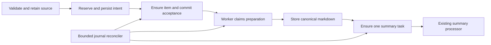

# Architecture follow-up proposals

Status: **design only; not implemented or deployed**. These proposals record the
approved design work, not approval to add fields, change product behavior, enable
release gates, alter credentials, or change resource settings. Implementation
needs a separately reviewed change with tests and an upgrade-in-place plan.

## 1. Readiness without restart loops

### Problem and current evidence

- [Web health](../apps/web/src/app/api/health/route.ts) checks SQL with `SELECT 1`
  but skips metadata validation in Azure-primary mode.
- [Worker health](../apps/worker/src/index.ts) queries a potentially expensive
  stuck-job count, converts a failure to `-1`, and still returns HTTP 200.
  `lastPollAt` advances before awaiting work, so it can be old during a healthy
  long narration.
- [Python health](../services/python-tts/app/main.py) reports package/asset
  discovery and process statistics, not successful construction of every
  configured model. Optional provider absence must not disable another provider.
- Item jobs already renew durable leases in
  [processItemJob](../apps/worker/src/jobs/processItemJob.ts); the three other
  workflows need equivalent observable progress semantics, not an assumed item
  lease. A lease heartbeat proves ownership renewal, not forward progress.

### Proposed contract

Keep all existing health URLs and status semantics unchanged during introduction.
Add separate readiness URLs: web `/api/ready`, worker and Python `/ready`.
Responses use `schemaVersion: 1`, `state: ready|degraded|not_ready`,
`checkedAt`, `expiresAt`, and component `state/reasonCode/lastSuccessAt`.
Return 200 only for ready or a clearly nonessential degraded dependency; return
503 for an unavailable required dependency or unknown/expired required result.
Unknown must not be encoded as success. Do not return credentials, user/job
identifiers, source text, connection strings or raw exception messages.

| Component | Required signal | Not a readiness requirement |
|---|---|---|
| Web | Selected metadata store read using a fixed synthetic probe key/query; bounded storage metadata access for the configured backend | Optional billing/analytics service, every user's object, ability to synthesize |
| Worker | Selected metadata and dispatch access; event-loop progress; current phase/ownership state | A recent new-job poll while actively processing; zero historical stuck jobs; overflow worker actively admitting work |
| Python | Required provider/language initialized successfully; known required assets; not draining/recycling | Every optional provider installed; a new synthesis on each probe |

Use one coalesced check batch per process with a 5-second result TTL, at most
three dependency operations in flight, 750 ms per operation and 2 seconds
overall. Abort supported I/O on deadline. For non-cancelable SDK calls, retain
the single-flight slot until completion so timed-out probes cannot accumulate
background work. Expose a timeout/unknown result, not a fresh successful cache.
These are proposed initial budgets, to be verified against representative
non-production latency before any gate consumes them. No table scan, write,
model construction or inference occurs in the request handling a probe.

Initialize configured models through a separate startup/warm-up action, using
the per-key initialization locks. Record `cold -> initializing -> ready|failed`;
readiness stays false while cold. An initial 300-second startup allowance is a
proposal, not evidence that every model loads within that time. Keep a required
provider failure explicit; optional missing providers remain diagnostic only.
Model readiness is neither proof of enough capacity for any input nor permission
to bypass the later inference-admission policy.

### Progress, ownership and actions

Record in-memory workflow/phase, phase start, last meaningful progress, phase
deadline and last successful ownership renewal for all four worker workflows.
Derive deadlines from their actual configured extraction/TTS/encoding timeouts
and retry budgets; do not infer a stall from the 15-minute default stale-job
window alone. Idle workers use poll-loop progress; intentionally idle overflow
workers are healthy with `admission: disabled_by_policy`.

| Scenario | Readiness / action | Restart? |
|---|---|---|
| Long inference within its phase deadline, ownership renewing | Ready/busy; old `lastPollAt` is informational | No |
| No progress beyond the phase deadline, even with live heartbeat | Not ready/stalled; stop new claims and alert; resolve the active attempt through its lease/cancellation contract | Not solely from this probe |
| Metadata outage or ownership renewal failure | Not ready; pause claims and forbid completion by an unowned attempt | No dependency-outage restart loop |
| Required model/asset missing or initialization failed | Not ready with safe reason code; reject affected new requests | Alert; bounded operator recovery |
| Optional unused provider missing | Ready with optional degradation | No |
| Process/event loop not responding to independent liveness | Existing supervisor policy applies | Only after its existing threshold |

### Consumers and rollout

Current source-controlled consumers are
[Compose](../docker-compose.parity.yml),
[parity startup](../scripts/parity-up.sh),
[CI](../.github/workflows/ci.yml),
[preview prewarm](../scripts/prewarm-kokoro-previews.sh),
[provider discovery](../apps/web/src/lib/tts.ts), and legacy
[deploy](../scripts/azure/deploy-changes.sh) /
[TLS checks](../scripts/azure/configure-tls.sh). Discovery wants capabilities;
startup/release checks want service readiness; a restart monitor wants liveness.
Do not silently redirect them all to the same signal. Inventory externally
managed release/monitoring consumers separately before changing any gate.

1. Add diagnostics and new endpoints in shadow mode; preserve old responses and
   all existing gate/supervisor settings.
2. Test outage, missing asset, expired cache, slow SDK, active long job and
   heartbeat-without-progress cases using controlled dependencies. Assert the
   2-second response ceiling, single-flight bound and safe response shape.
3. Observe false positives across cold starts, valid longest jobs and planned
   recycling. Approve timeout values and each consumer's action explicitly.
4. Migrate one startup/readiness consumer at a time; keep automatic restart on
   independent liveness, not dependency readiness. No changes are enabled now.

No persisted migration is needed for ephemeral diagnostics. If cross-process
progress is later required, design additive fields/compatibility before writing
them. Rollback switches consumers back first, then removes the new endpoints;
it never resets jobs, accounts or model caches.

## 2. Durable acceptance before summary preparation

### Problem and product reconciliation

[enqueueItem](../apps/web/src/lib/items.ts) saves quota/item state, then extracts
and stores markdown in the web process, then creates `ArticleSummaryTask`.
The [task processor](../apps/worker/src/jobs/processArticleSummaryTask.ts) only
discovers tasks and requires existing markdown. A process interruption between
these steps strands an item; moving extraction alone would instead make current
tasks fail for missing markdown.

The [current task contract](article-summary-task-processing.md) and
[summary route tests](../apps/web/tests/summary-mode-routes.test.ts) deliberately
require preparation before task creation. Keep that contract: introduce
discoverable **preparation intent**, not an audio job or an unprepared legacy
summary task. This proposal changes where preparation runs and when users see
extraction failures. It does not claim the old synchronous behavior already
provides durable acceptance.

### Proposed acceptance and ownership

Use the submission-operation journal described in the quota proposal, rather
than a second independent reservation mechanism. Its proposed fields include
protocol version, user-scoped submission ID, request-content hash, stable item
ID, quota reservation reference, durable source reference, preparation phase,
attempt/owner epoch, due time, safe failure and cancellation state.

1. Authenticate and validate input/rate limits in the web request. Preserve URL
   scheme/SSRF rules, PDF type/size checks and transcript-only restrictions.
   Store PDF/snapshot bytes durably before accepting; a browser temporary file,
   expiring download link or web-process-local path is not a recoverable source.
2. Reserve existing-policy capacity and persist recoverable operation intent.
   Create/project the item, then commit the operation as accepted. In SQL,
   quota/item/intent can share a transaction. In Azure, use the account-partition
   journal/reservation protocol; cross-partition item writes remain resumable
   projections, not an imaginary transaction.
3. Return the existing successful response shape/status only after accepted
   intent and its item are durable. Add an operation ID and preparing phase;
   titles may initially be placeholders. A timeout with uncertain commit returns
   an explicit pending/error outcome with the operation ID, not "not charged" or
   "completed." Retrying the same idempotency key resolves that outcome.
4. The worker claims preparation with an owner epoch, extracts through the
   existing adapters, writes owned artifacts, records their hash/reference, then
   idempotently creates the normal summary task. Preparation must be discoverable
   from the authoritative journal even if dispatch/index creation fails.
5. Run preparation as a subqueue of the existing article-summary category,
   alternating preparation and ready-summary work when both are eligible. Keep
   the four-category equal round-robin policy; do not make a fifth priority lane.
   Bound each scan with continuation and rotate partitions, rather than repeatedly
   selecting the first page. Queue messages are hints, not the only evidence.

An idempotency key is scoped to the authenticated user and bound to the immutable
request hash (mode, source and options). Same key/same body returns the original
operation; same key/different body is a conflict. An intentional new submission
uses a new key. Keep a compact deduplication tombstone after cleanup so late
retries cannot become a new charge. Never log the source text or secret URLs.

### Failure and recovery matrix

| Interruption/failure | Durable fact and recovery |
|---|---|
| Upload persisted, no intent | Not accepted; reclaim only demonstrably unreferenced staging bytes after a grace period |
| Capacity reserved, item/acceptance not complete | Journal exposes incomplete operation; conditionally finish it or compensate the unaccepted reservation; do not charge again |
| Acceptance committed, response lost or no worker hint | Same-key retry returns same item; journal reconciliation recreates the hint and preparation work |
| Extraction interrupted | Retry the same operation/source with a bounded attempt budget; no quota call |
| Artifact upload succeeds before metadata save | Reuse a verified object or collect an unreferenced attempt object later; old owners cannot overwrite the winning reference |
| Markdown saved, task creation/phase acknowledgement interrupted | Deterministic task identity plus conditional creation converges to one task; validate existing task ownership/content |
| URL expires or source is unsupported/empty | Persist a terminal, user-visible extraction error and guidance; no hidden audio fallback, infinite fetch retry or new charge |
| Cancellation/deletion races with preparation | Cancellation generation/tombstone fences all subsequent writes; never recreate a deleted item or task |
| Summary provider fails later | Existing bounded task retry behavior; preserve canonical markdown and the same submission identity |

Use current retry classifications as the starting point: transient storage/
network failures may retry with backoff; invalid/expired source failures are
terminal until an explicit user action. A retry of the same accepted work is not
a new quota admission. Accepted extraction failures retain the existing usage
policy; releasing an unaccepted reservation is not a refund-policy change.

### Migration, validation and rollback

This needs additive SQL/Azure journal fields/entities and a worker capability
gate. First deploy readers/reconciler that understand the new protocol, retaining
the current prepared-markdown task contract; then enable new acceptance writers
for a small cohort only after every eligible worker supports preparation.
Old workers may continue processing fully prepared legacy tasks, but must never
receive new preparation records as ordinary summary tasks.

Backfill is a dry-run inventory first: distinguish missing-task items with
verified markdown, interrupted preparations with retained sources, terminal
failures, canceled/deleted items and unknown legacy state. Repair only proven
cases with deterministic identities and conditional writes; report unknown
cases instead of guessing acceptance or replaying usage. Do not reset counters,
rewrite public feed identities, or create audio work for summary-only imports.

Required implementation tests inject a stop before/after each matrix boundary
in both stores, including loss of HTTP response, missing dispatch hint, duplicate
request, stale worker, expired source and delete race. Assert accepted work
converges to one summary or a durable terminal error without another charge.
Update route/UI tests to expect asynchronous extraction and provisional titles.

Rollback disables new-protocol acceptance first and leaves a compatible worker/
reconciler draining existing operations. Do not roll back to binaries unable to
read outstanding intents; retain additive data and the old prepared-task reader.
